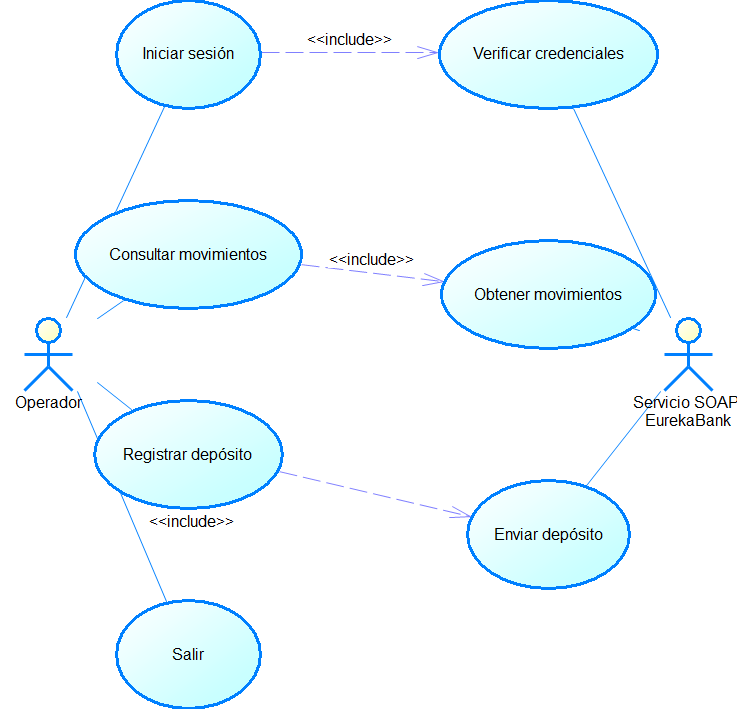

---
lang: es
---

```{=openxml}
<w:p><w:r><w:br w:type="page"/></w:r></w:p>
```

```{=openxml}
<w:p><w:pPr><w:pStyle w:val="TtuloTDC"/></w:pPr><w:r><w:t>ÍNDICE DE TABLAS</w:t></w:r></w:p>
<w:p><w:r><w:fldChar w:fldCharType="begin"/></w:r><w:r><w:instrText xml:space="preserve"> TOC \h \z \c "Table" </w:instrText></w:r><w:r><w:fldChar w:fldCharType="separate"/></w:r><w:r><w:t>Actualizar índice de tablas</w:t></w:r><w:r><w:fldChar w:fldCharType="end"/></w:r></w:p>
<w:p><w:pPr><w:pStyle w:val="TtuloTDC"/></w:pPr><w:r><w:t>ÍNDICE DE ILUSTRACIONES</w:t></w:r></w:p>
<w:p><w:r><w:fldChar w:fldCharType="begin"/></w:r><w:r><w:instrText xml:space="preserve"> TOC \h \z \c "Figure" </w:instrText></w:r><w:r><w:fldChar w:fldCharType="separate"/></w:r><w:r><w:t>Actualizar índice de ilustraciones</w:t></w:r><w:r><w:fldChar w:fldCharType="end"/></w:r></w:p>
<w:p><w:r><w:br w:type="page"/></w:r></w:p>
```

# Caso de estudio {.unnumbered}

El cliente EurekaBank de consola ofrece a un operador un flujo textual para autenticarse, consultar los movimientos de una cuenta, solicitar depósitos y salir. El programa Java consume las operaciones publicadas por el servidor SOAP. La persistencia bancaria corresponde al servicio remoto; la clase de acceso JDBC presente en el proyecto de consola no forma parte del flujo que ejecuta el menú.

Esta especificación describe el comportamiento identificable en el repositorio del cliente. El menú llama a login, traerMovimientos y regDeposito. Las entradas no quedan ligadas a una sesión autenticada en el servidor, y la pantalla de depósito solicita un dato adicional que el código no envía. Se registran esas diferencias para que una demostración no confunda el flujo implementado con un resultado bancario confirmado.

: Tabla 1. Dato y Valor

| Dato | Valor |
|---|---|
| Proyecto | EurekaBank SOAP Java, cliente de consola |
| Equipo | Grupo 1 |
| Versión del ERS | 1.0 |
| Fecha de la línea base | 21 de octubre de 2026 |
| Estado | Descripción basada en el código disponible |

# 1 Introducción

Este ERS define las funciones, entradas, respuestas e interfaces del cliente de consola EurekaBank. Está dirigido a quienes mantienen el cliente, revisan el contrato de servicio y preparan el entorno de ejecución. Su conclusión principal es que la aplicación ofrece un flujo de autenticación local y un menú, mientras las operaciones bancarias se solicitan por SOAP y dependen del servicio publicado en Payara Server Community 7.

La consola se apoya en clases cliente generadas a partir de WSDL. El usuario introduce credenciales, selecciona una operación y proporciona los datos de cuenta o importe. El cliente convierte los resultados a texto y presenta movimientos en columnas. Las garantías de autenticación, validez de cuenta, actualización de saldo y registro transaccional pertenecen al servicio y a la base de datos remotos.

# 2 Propósito

El propósito es establecer una línea base verificable para el cliente existente, describir criterios de aceptación y señalar las condiciones necesarias para corregir y ampliar la interfaz. El documento no declara que una ejecución de laboratorio o una operación financiera haya sido aprobada.

# 3 Alcance

El alcance cubre el proceso de inicio de sesión, el menú de depósitos y movimientos, la presentación de resultados y la salida de la aplicación. Incluye el adaptador SOAP y el modelo de movimiento utilizados por esas funciones. El servidor SOAP se considera una dependencia desplegada en Payara Server Community 7; este documento no especifica sus componentes internos.

La línea base no ofrece transferencias, retiros, gestión de usuarios, recuperación de contraseña ni administración bancaria. No implementa un cierre de sesión remoto ni transmite un token en cada llamada. La consulta y el depósito siguen usando el endpoint configurado en el WSDL generado, por lo que el entorno debe mantener ese contrato y una ruta accesible desde el equipo cliente.

: Tabla 2. Función incluida y Resultado observable

| Función incluida | Resultado observable |
|---|---|
| Inicio de sesión | Mensaje de acceso aceptado o rechazado |
| Consulta | Tabla textual con los movimientos recibidos o aviso de lista vacía |
| Depósito | Mensaje basado en el entero retornado por el servicio |
| Menú | Opciones de depósito, movimientos y salida |
| Fuera de alcance | Administración de cuentas, autorización por operación, reversos y auditoría del operador |

# 4 Definiciones acrónimos y abreviaturas

: Tabla 3. Término y Definición

| Término | Definición |
|---|---|
| Cliente | Programa de consola que inicia las solicitudes SOAP |
| SOAP | Protocolo de mensajes XML usado para invocar operaciones remotas |
| WSDL | Contrato que describe operaciones, parámetros y tipos publicados |
| Movimiento | Registro bancario con cuenta, número, fecha, tipo, acción e importe |
| Resultado incierto | El cliente pierde la respuesta y no puede inferir el estado remoto |
| Payara 7 | Servidor de aplicaciones Java previsto para alojar el servicio EurekaBank |

# 5 Referencias del código

: Tabla 4. C1 WSEurekaClienteConsola.java

| ID | Fuente | Responsabilidad documentada |
|---|---|---|
| C1 | WSEurekaClienteConsola.java | Entrada principal, menú y presentación textual |
| C2 | Login.java | Traduce el resultado login a un booleano local |
| C3 | EurekaService.java y clases generadas | Invocaciones login, traerMovimientos y regDeposito |
| C4 | Movimiento.java | Datos del movimiento recibidos por SOAP |
| C5 | AccesoDB.java | Conexión JDBC incluida en el proyecto, separada del flujo del menú |
| C6 | WSEureka.wsdl | Contrato y dirección del servicio que consume el cliente |

# 6 Visión general del documento

Las secciones iniciales fijan propósito, alcance y vocabulario. La descripción general explica los actores, dependencias y límites. La especificación presenta los casos de uso y los requisitos funcionales y no funcionales. Las últimas secciones agrupan reglas, rendimiento, trazabilidad y recomendaciones. Los estados diferencian el comportamiento visible en el código de la aceptación aún pendiente.

# 7 Descripción general

## 7.1 Perspectiva del producto

El cliente es una aplicación Java independiente con entrada estándar y salida de texto. Su capa de servicio usa los proxies creados con JAX-WS para acceder al endpoint del WSDL. La aplicación puede arrancar sin abrir una ventana gráfica y no contiene una sesión bancaria compartida con el servicio.

: Tabla 5. Componente y Responsabilidad

| Componente | Responsabilidad |
|---|---|
| Operador | Escribe credenciales, elige una opción y proporciona datos |
| Menú | Mantiene el ciclo local de opciones y dirige el flujo |
| Adaptador generado | Serializa solicitudes y deserializa respuestas SOAP |
| Servicio EurekaBank | Valida y procesa las operaciones remotas |
| Payara Server Community 7 | Aloja el servicio SOAP EurekaBank |
| MySQL | Conserva los datos bancarios gestionados por el servicio |

## 7.2 Funciones del producto

: Tabla 6. Función y Entrada principal

| Función | Entrada principal | Salida |
|---|---|---|
| Autenticarse | Usuario y contraseña | Resultado de login y mensaje local |
| Consultar movimientos | Número de cuenta | Registros en orden devuelto por el servicio |
| Solicitar depósito | Cuenta e importe | Resultado entero interpretado como éxito o fallo |
| Salir | Opción del menú | Fin del ciclo de consola |

## 7.3 Usuarios y entorno

El usuario es un operador que puede introducir datos desde una terminal con entrada estándar. El cliente requiere una JVM compatible con la versión de compilación declarada por el proyecto, sus dependencias de servicio web y conectividad hacia el endpoint SOAP. El servicio remoto debe estar desplegado y accesible en Payara Server Community 7, con su acceso a MySQL configurado por separado.

## 7.4 Restricciones y supuestos

El contrato generado condiciona nombres, tipos y respuestas. El cliente convierte fechas XML a fecha local para mostrarlas; un error de conversión produce un mensaje para esa fila. La lectura de opciones numéricas usa Scanner y no define una recuperación completa frente a texto no numérico. El flujo de depósito lee cuenta e importe y luego solicita un código que no se transmite; el código no participa en la operación.

: Tabla 7. Restricción y Efecto

| Restricción | Efecto |
|---|---|
| Endpoint incorporado en la referencia WSDL | Un cambio de servidor puede requerir regenerar o configurar el cliente |
| Sin token o sesión remota | Login no autoriza de forma verificable las llamadas posteriores |
| Resultado de depósito entero | El usuario no recibe un identificador de transacción ni detalle de causa |
| Acceso JDBC local heredado | No debe tratarse como ruta funcional del menú ni como sustituto del servicio |

# 8 Especificación de requisitos

## 8.1 Interfaces externas

: Tabla 8. Interfaz y Datos intercambiados

| Interfaz | Datos intercambiados |
|---|---|
| Consola estándar | Credenciales, opción, cuenta e importe |
| SOAP login | usuario y contrasena; entero de resultado |
| SOAP traerMovimientos | cuenta; lista de objetos Movimiento o fallo SOAP |
| SOAP regDeposito | cuenta e importe; entero de resultado |
| Payara a MySQL | Persistencia remota fuera del cliente |

El código de consola contiene una clase JDBC con URL y credenciales fijadas localmente. La ruta de menú utiliza EurekaService y no la clase AccesoDB; la configuración y las credenciales de esa clase no se deben copiar a una guía de despliegue ni considerar evidencia de una operación bancaria funcional.

## 8.2 Objetivos y actor

: Tabla 9. OBJ-01 Facilitar el acceso textual a las operaciones SOAP de EurekaBank

| ID | Objetivo |
|---|---|
| OBJ-01 | Facilitar el acceso textual a las operaciones SOAP de EurekaBank |
| OBJ-02 | Permitir consultar movimientos para una cuenta ingresada |
| OBJ-03 | Permitir solicitar un depósito y presentar su resultado |
| OBJ-04 | Mantener una interacción local comprensible en una terminal |

: Tabla 10. Actor y Participación

| Actor | Participación |
|---|---|
| Operador | Inicia sesión, consulta, deposita y sale |
| Servicio SOAP EurekaBank | Recibe solicitudes y devuelve resultados |

## 8.3 Casos de uso

{width=14cm}

: Tabla 11. Caso y Precondición

| Caso | Precondición | Flujo y resultado |
|---|---|---|
| CU-01 Iniciar sesión | Servicio SOAP accesible | El cliente pide usuario y contraseña, invoca login y habilita el menú únicamente cuando Login devuelve verdadero |
| CU-02 Consultar movimientos | Menú local abierto | Pide una cuenta, llama traerMovimientos y presenta cada movimiento o informa que la lista está vacía |
| CU-03 Registrar depósito | Menú local abierto | Pide cuenta e importe, llama regDeposito y presenta un mensaje según el entero recibido |
| CU-04 Salir | Menú local abierto | Seleccionar la opción de salida termina el ciclo local |

## 8.4 Requisitos funcionales

: Tabla 12. RF-01 Solicitar credenciales e invocar login

| ID | Requisito | Prioridad | Estado |
|---|---|---|---|
| RF-01 | Solicitar credenciales e invocar login | Alta | Implementado en el flujo de consola |
| RF-02 | Mostrar opciones de depósito, movimientos y salida tras login aceptado | Alta | Implementado |
| RF-03 | Consultar y presentar los movimientos de una cuenta | Alta | Implementado con manejo básico de lista vacía |
| RF-04 | Enviar un depósito y mostrar el resultado entero | Alta | Implementado; el código adicional solicitado no se usa |
| RF-05 | Terminar la interacción cuando se selecciona salir | Media | Implementado |

### Fichas de requisitos funcionales

: Tabla 13. RF-01 Iniciar sesión

| Campo | RF-01 Iniciar sesión |
|---|---|
| Descripción | El cliente recibirá usuario y contraseña por entrada estándar y llamará a la operación login. |
| Criterio de aceptación | El menú aparece si el resultado es 1; para otro resultado se muestra login fallido y termina el flujo. |
| Trazabilidad | CU-01; C1, C2, C3 |
| Observación | La contraseña se lee como String y el programa no implementa borrado de memoria ni autenticación local adicional. |

: Tabla 14. RF-02 Menú de operaciones

| Campo | RF-02 Menú de operaciones |
|---|---|
| Descripción | El cliente presentará las opciones disponibles después de aceptar login. |
| Criterio de aceptación | Las opciones permiten acceder a depósito, consulta y salida; una opción fuera del conjunto se marca como inválida. |
| Trazabilidad | CU-02, CU-03, CU-04; C1 |
| Observación | Una entrada no numérica no tiene recuperación controlada. |

: Tabla 15. RF-03 Consultar movimientos

| Campo | RF-03 Consultar movimientos |
|---|---|
| Descripción | El cliente solicitará una cuenta y presentará cuenta, número, fecha, tipo, acción e importe de cada objeto retornado. |
| Criterio de aceptación | Una lista vacía produce aviso; una lista con registros se muestra en filas tabulares. |
| Trazabilidad | CU-02; C1, C3, C4 |
| Observación | El contrato no publica paginación; el cliente muestra la lista completa recibida. |

: Tabla 16. RF-04 Solicitar depósito

| Campo | RF-04 Solicitar depósito |
|---|---|
| Descripción | El cliente enviará cuenta e importe mediante regDeposito e interpretará 1 como confirmación y los demás resultados como fallo. |
| Criterio de aceptación | El mensaje corresponde al entero retornado y nunca declara éxito si se recibe otro valor. |
| Trazabilidad | CU-03; C1, C3 |
| Observación | El código que se solicita tras el importe no se envía. Si se pierde la respuesta, no existe clave de idempotencia para resolver el resultado incierto. |

: Tabla 17. RF-05 Salir

| Campo | RF-05 Salir |
|---|---|
| Descripción | La opción de salida finalizará el bucle del menú. |
| Criterio de aceptación | El programa deja de presentar opciones después de elegir salir. |
| Trazabilidad | CU-04; C1 |
| Observación | No se invoca un cierre de sesión en el servidor. |

## 8.5 Reglas de negocio y datos

: Tabla 18. RN-01 El resultado de login es el único control de entrada al menú local.

| ID | Regla |
|---|---|
| RN-01 | El resultado de login es el único control de entrada al menú local. |
| RN-02 | La cuenta e importe enviados dependen del contrato de regDeposito. |
| RN-03 | La confirmación mostrada representa la respuesta recibida; no se debe inferir una confirmación si hubo error de transporte. |
| RN-04 | El código de movimiento capturado por la consola no participa en la solicitud actual. |
| RN-05 | Una consulta no modifica los datos bancarios. |

: Tabla 19. Dato y Uso

| Dato | Uso |
|---|---|
| usuario | Identificador enviado durante login |
| contrasena | Secreto enviado durante login |
| cuenta | Identificador de cuenta enviado a consulta o depósito |
| importe | Valor decimal convertido a double por el cliente |
| Movimiento | Cuenta, número, fecha, tipo, acción e importe recibidos |
| resultado | Entero remoto que el cliente interpreta localmente |

# 9 Requisitos no funcionales

: Tabla 20. RNF-01 Interoperabilidad El cliente debe consumir el WSDL desplegado en Payara Server Community 7

| ID | Requisito | Estado y criterio de revisión |
|---|---|---|
| RNF-01 Interoperabilidad | El cliente debe consumir el WSDL desplegado en Payara Server Community 7 | Revisar operación, namespace, endpoint y tipos con el contrato vigente |
| RNF-02 Usabilidad | Los mensajes deben distinguir acceso, lista vacía, depósito y salida | Verificar cada mensaje con respuestas controladas |
| RNF-03 Manejo de errores | Los fallos SOAP deben comunicarse como error y no como operación confirmada | Falta un tratamiento uniforme de excepciones en el menú |
| RNF-04 Protección de secretos | Credenciales bancarias no deben almacenarse en el código fuente | La clase AccesoDB contiene configuración local heredada; retirarla o externalizarla |
| RNF-05 Rendimiento | El cliente debe tolerar la latencia del servicio remoto sin afirmar un tiempo máximo no medido | Registrar mediciones en un entorno definido antes de fijar umbrales |
| RNF-06 Mantenibilidad | El WSDL generado y la lógica de presentación deben permanecer separados | Revisar el proceso de regeneración ante cambios del servicio |

## 9.1 Restricciones, calidad y rendimiento

La consola comparte la conectividad y disponibilidad del servicio. No se encontraron mediciones de latencia, límite de historial ni número de usuarios simultáneos. Una consulta grande puede aumentar el tiempo de respuesta y la memoria utilizada. Las excepciones, la respuesta perdida de un depósito y el formato inválido de entrada requieren atención explícita antes de elevar la línea base.

: Tabla 21. Escenario y Evidencia que debe obtenerse

| Escenario | Evidencia que debe obtenerse |
|---|---|
| Login aceptado y rechazado | Respuesta del servicio y transición al menú |
| Consulta vacía y con datos | Resultado, formato de fecha y columnas mostradas |
| Entrada de menú inválida | Mensaje y continuidad del ciclo |
| Depósito confirmado o rechazado | Entero retornado y mensaje asociado |
| Tiempo de espera agotado | Mensaje de fallo sin declaración de éxito |

# Trazabilidad y aceptación

: Tabla 22. Caso y Requisitos

| Caso | Requisitos | Componentes |
|---|---|---|
| CU-01 | RF-01, RF-02, RNF-01, RNF-03 | Menú, Login, proxy SOAP |
| CU-02 | RF-02, RF-03, RNF-01, RNF-02 | Menú, EurekaService, Movimiento |
| CU-03 | RF-02, RF-04, RNF-03, RNF-04 | Menú, EurekaService, servicio remoto |
| CU-04 | RF-05, RNF-02 | Menú |

La aceptación debe probar entradas y respuestas representativas en un entorno con el servicio SOAP desplegado en Payara 7. Para depósitos, debe conservarse la respuesta recibida y contrastarse con el movimiento bancario posterior. Una salida local de éxito no sustituye la comprobación del estado persistido.

# Recomendaciones

Retirar del flujo y del repositorio cualquier configuración JDBC que no corresponda al cliente SOAP; externalizar el endpoint; validar opciones y valores decimales antes de invocar; corregir la lectura adicional no usada en depósito; establecer mensajes distintos para rechazo, error SOAP y resultado incierto; y considerar un identificador de solicitud antes de habilitar reintentos de operaciones financieras.

# Conclusiones

El cliente de consola cubre el acceso textual a login, consulta y depósito mediante el servicio EurekaBank. La implementación actual no demuestra una sesión remota ni propaga el código de movimiento solicitado por pantalla. La especificación separa esos hechos de las mejoras propuestas y fija los criterios que deben comprobarse antes de aceptar una versión revisada.

# Bibliografía y fuentes técnicas

Las fuentes técnicas son las clases Java, el WSDL local y los manifiestos del propio cliente y servidor EurekaBank. La versión del servicio, su disponibilidad, la configuración de MySQL y las operaciones reales deben verificarse en el entorno Payara de destino antes de ejecutar la aceptación.