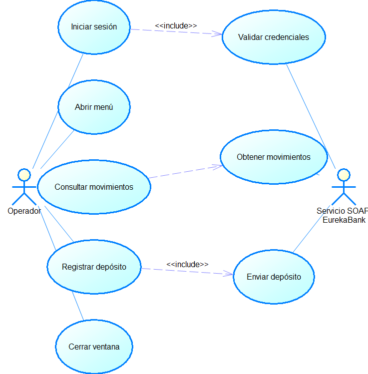

```{=openxml}
<w:p><w:r><w:br w:type="page"/></w:r></w:p>
```

```{=openxml}
<w:p><w:pPr><w:pStyle w:val="TtuloTDC"/></w:pPr><w:r><w:t>ÍNDICE DE TABLAS</w:t></w:r></w:p>
<w:p><w:r><w:fldChar w:fldCharType="begin"/></w:r><w:r><w:instrText xml:space="preserve"> TOC \h \z \c "Table" </w:instrText></w:r><w:r><w:fldChar w:fldCharType="separate"/></w:r><w:r><w:t>Actualizar índice de tablas</w:t></w:r><w:r><w:fldChar w:fldCharType="end"/></w:r></w:p>
<w:p><w:pPr><w:pStyle w:val="TtuloTDC"/></w:pPr><w:r><w:t>ÍNDICE DE ILUSTRACIONES</w:t></w:r></w:p>
<w:p><w:r><w:fldChar w:fldCharType="begin"/></w:r><w:r><w:instrText xml:space="preserve"> TOC \h \z \c "Figure" </w:instrText></w:r><w:r><w:fldChar w:fldCharType="separate"/></w:r><w:r><w:t>Actualizar índice de ilustraciones</w:t></w:r><w:r><w:fldChar w:fldCharType="end"/></w:r></w:p>
<w:p><w:r><w:br w:type="page"/></w:r></w:p>
```

# Caso de estudio {.unnumbered}

El cliente de escritorio EurekaBank es una aplicación Java Swing que permite iniciar sesión, abrir las ventanas de consulta de movimientos y depósito, y presentar los resultados del servicio SOAP en controles gráficos. El servicio bancario y la persistencia se encuentran fuera de la aplicación cliente, en el entorno previsto para Payara Server Community 7.

La especificación describe lo que implementan las vistas `LoginVista`, `MenuVista`, `MovimientosVista` y `DepositosVista`, junto con `EurekaControlador` y los proxies JAX-WS. Se identifican validaciones y límites que no están resueltos en el código, especialmente el análisis del importe y la diferencia entre la clase `Login` existente y el flujo de autenticación que usa la vista.

: Tabla 1. Dato y Valor

| Dato | Valor |
|---|---|
| Proyecto | EurekaBank SOAP Java, cliente de escritorio |
| Equipo | Grupo 1 |
| Versión del ERS | 1.0 |
| Fecha de la línea base | 21 de octubre de 2026 |
| Estado | Requisitos basados en fuentes Java y WSDL disponibles |

# 1 Introducción

Este ERS fija los requisitos observables del cliente de escritorio EurekaBank. Está dirigido al equipo que mantiene las ventanas Swing, el adaptador SOAP y la configuración de ejecución. La aplicación presenta formularios y resultados; las decisiones de autenticación, consulta y depósito dependen del servicio remoto desplegado en Payara Server Community 7.

La vista de acceso envía usuario y contraseña por medio de `EurekaControlador`. Si el servicio retorna 1, la aplicación abre el menú y cierra la ventana de login. La consulta transforma movimientos en filas de una tabla. El depósito convierte el importe con `Double.parseDouble`, llama a `regDeposito` y presenta un mensaje según el entero retornado.

# 2 Propósito

El propósito es documentar una línea base verificable para el cliente Swing, delimitar su contrato de servicio, describir sus requisitos funcionales y señalar las condiciones que debe satisfacer su aceptación. No se atribuyen al cliente transacciones confirmadas ni controles que correspondan al servidor.

# 3 Alcance

El alcance cubre inicio de sesión, navegación entre ventanas, consulta de movimientos, envío de depósitos, presentación de respuesta y cierre de ventanas. Incluye la capa controladora, el cliente JAX-WS, las estructuras de movimiento y los recursos de interfaz.

No incluye administración bancaria, creación de usuarios, transferencias, retiros, recuperación de credenciales, autorización por operación ni lógica de persistencia. `AccesoDB` existe en el proyecto, pero las acciones de las vistas consultadas pasan por las operaciones SOAP y no por esa clase.

: Tabla 2. Función y Resultado observable

| Función | Resultado observable | Límite principal |
|---|---|---|
| Inicio de sesión | Abre el menú si `login` retorna 1; presenta rechazo en otro caso | No persiste una sesión remota |
| Menú | Abre la vista de consulta o depósito | Cada ventana se lanza con su propio método `main` |
| Consulta | Presenta movimientos en una tabla Swing | La disponibilidad y el formato dependen del servicio |
| Depósito | Presenta mensaje de éxito o error según el entero | No valida el texto antes de convertirlo a número |
| Salida | Cierra la ventana actual | No representa un cierre de sesión SOAP |

# 4 Definiciones, acrónimos y abreviaturas

: Tabla 3. Término y Definición

| Término | Definición |
|---|---|
| Swing | Biblioteca Java para construir la interfaz gráfica de escritorio |
| SOAP | Protocolo de mensajes XML usado para invocar operaciones remotas |
| JAX-WS | API Java usada por el proxy generado para consumir el servicio |
| WSDL | Contrato que define operaciones, parámetros y tipos SOAP |
| Movimiento | Registro bancario retornado por la consulta del servicio |
| Payara 7 | Servidor de aplicaciones Java previsto para alojar EurekaBank |
| Resultado incierto | La respuesta no permite al cliente conocer el estado final remoto |

# 5 Referencias del código

: Tabla 4. Código y Responsabilidad

| ID | Fuente | Responsabilidad observada |
|---|---|---|
| C1 | `LoginVista.java` | Captura credenciales, invoca login y navega al menú |
| C2 | `MenuVista.java` | Abre las ventanas de movimientos y depósitos |
| C3 | `MovimientosVista.java` | Solicita cuenta y presenta los registros en tabla |
| C4 | `DepositosVista.java` | Convierte el importe, invoca depósito y muestra el mensaje |
| C5 | `EurekaControlador.java` | Delega login, consulta y depósito a `EurekaService` |
| C6 | `EurekaService.java` y proxies JAX-WS | Invocan operaciones del servicio remoto |
| C7 | `Movimiento.java` | Representa los campos del movimiento retornado |
| C8 | WSDL bajo `src/META-INF/wsdl` | Contrato y endpoint usado para generar el proxy |
| C9 | `AccesoDB.java` | Acceso JDBC auxiliar incluido, fuera del flujo de las vistas |

# 6 Visión general del documento

Las secciones iniciales establecen contexto, alcance y vocabulario. La descripción general presenta la arquitectura y las restricciones. La especificación incluye interfaces, actores, casos de uso y requisitos funcionales detallados. Las últimas secciones registran calidad, trazabilidad, recomendaciones y condiciones de aceptación.

# 7 Descripción general

## 7.1 Perspectiva del producto

El producto es una aplicación Java de escritorio. Las vistas Swing manejan la captura y presentación; `EurekaControlador` dirige las llamadas; `EurekaService` crea el proxy JAX-WS, que consume el contrato SOAP disponible en el entorno de Payara 7. El servicio remoto administra el resultado bancario y la persistencia.

: Tabla 5. Componente y Responsabilidad

| Componente | Responsabilidad |
|---|---|
| Operador | Introduce credenciales, cuenta e importe y elige una operación |
| `LoginVista` | Envía credenciales y muestra el resultado de acceso |
| `MenuVista` | Navega a consulta y depósito |
| `MovimientosVista` | Presenta filas y columnas de movimientos |
| `DepositosVista` | Solicita cuenta e importe y presenta respuesta |
| `EurekaControlador` | Expone operaciones usadas por las vistas |
| `EurekaService` / JAX-WS | Serializa solicitudes y procesa respuestas SOAP |
| Payara Server Community 7 | Aloja el servicio SOAP EurekaBank |
| MySQL | Persiste datos gestionados por el servicio remoto |

## 7.2 Funciones del producto

: Tabla 6. Función y Entrada

| Función | Entrada | Resultado esperado |
|---|---|---|
| Login | Usuario y contraseña | Menú o mensaje de rechazo |
| Consulta | Número de cuenta | Filas con los datos del movimiento o resultado vacío |
| Depósito | Cuenta e importe decimal | Mensaje asociado al resultado entero SOAP |
| Navegación | Selección de botón | Apertura de la vista seleccionada |
| Cierre | Acción de cerrar ventana | Terminación de la ventana actual |

## 7.3 Usuarios y entorno

El usuario es un operador que interactúa mediante ratón y teclado. El cliente necesita una JVM compatible con la configuración del proyecto, acceso de red al endpoint WSDL y conectividad entre el servidor de aplicaciones Payara 7 y la base de datos remota.

## 7.4 Restricciones y dependencias

El código genera proxies JAX-WS a partir del WSDL del proyecto. La vista de depósito convierte texto a `double` sin captura local de errores de formato. La clase `Login` usa una llamada estática diferente y no es el flujo invocado por `LoginVista`. La clase JDBC auxiliar no demuestra que las vistas persistan localmente.

: Tabla 7. Restricción y Efecto

| Restricción | Efecto |
|---|---|
| Endpoint definido por el proxy/WSDL | Cambiar entorno puede exigir regenerar o reconfigurar el proxy |
| `Double.parseDouble` sin validación | Entrada vacía o inválida puede interrumpir el evento de Swing |
| No hay token entre llamadas | El login no vincula de forma verificable las operaciones posteriores |
| `AccesoDB` separado de las vistas | No debe confundirse con la ruta de depósito SOAP |
| Servicio y base de datos externos | Sin conectividad no se completan las operaciones remotas |

# 8 Especificación de requisitos

## 8.1 Interfaces externas

: Tabla 8. Interfaz y Solicitud

| Interfaz | Solicitud y respuesta |
|---|---|
| Formularios Swing | Captura de usuario, contraseña, cuenta e importe |
| SOAP `login` | Usuario y contraseña; resultado entero |
| SOAP `traerMovimientos` | Cuenta; lista de objetos `Movimiento` |
| SOAP `regDeposito` | Cuenta e importe; resultado entero |
| Payara y MySQL | Despliegue del servicio y persistencia remota |

## 8.2 Objetivos y actores

: Tabla 9. Objetivo y Descripción

| ID | Objetivo | Descripción |
|---|---|---|
| OBJ-01 | Facilitar autenticación desde escritorio | Proporcionar credenciales a `login` y distinguir acceso aceptado |
| OBJ-02 | Consultar movimientos | Recuperar y presentar registros de una cuenta |
| OBJ-03 | Solicitar depósito | Enviar cuenta e importe y presentar el resultado del servicio |
| OBJ-04 | Separar interfaz y operación remota | Usar el servicio SOAP publicado en Payara 7 |

: Tabla 10. Actor y Participación

| Actor | Participación |
|---|---|
| Operador de escritorio | Inicia sesión, navega, consulta, deposita y cierra ventanas |
| Servicio SOAP EurekaBank | Valida credenciales y procesa las operaciones solicitadas |
| Responsable de despliegue | Publica servicio y configura el endpoint en el entorno Payara 7 |

## 8.3 Casos de uso

{width=14cm}

: Tabla 11. Caso y Precondición

| Caso | Precondición | Resultado observable |
|---|---|---|
| CU-01 Iniciar sesión | Servicio SOAP disponible | Resultado 1 abre el menú; otro resultado muestra rechazo |
| CU-02 Navegar | Menú visible | Abre la vista de movimientos o depósitos |
| CU-03 Consultar movimientos | Cuenta ingresada y servicio accesible | Presenta registros recibidos en tabla |
| CU-04 Registrar depósito | Cuenta, importe y endpoint disponibles | Presenta mensaje conforme al resultado entero |
| CU-05 Cerrar ventana | Ventana abierta | Cierra la ventana actual sin cerrar sesión remota |

## 8.4 Requisitos funcionales

: Tabla 12. Requisito y Estado

| ID | Requisito | Prioridad | Estado observado |
|---|---|---|---|
| RF-01 | Capturar credenciales e invocar `login` | Alta | Implementado en `LoginVista` |
| RF-02 | Abrir menú tras resultado de login aceptado | Alta | Implementado |
| RF-03 | Consultar y presentar movimientos por cuenta | Alta | Implementado; depende de SOAP |
| RF-04 | Enviar depósito y presentar resultado | Alta | Implementado; manejo del importe incompleto |
| RF-05 | Permitir cierre de las ventanas | Media | Definido por la configuración de las vistas |

### Fichas de requisitos funcionales

: Tabla 13. RF-01 Inicio de sesión

| Campo | RF-01 Inicio de sesión |
|---|---|
| Descripción | La vista capturará usuario y contraseña y llamará `EurekaControlador.login`. |
| Criterio de aceptación | Cuando el resultado sea 1, se abre `MenuVista` y se cierra el login; de lo contrario se informa rechazo. |
| Trazabilidad | CU-01; C1, C5, C6 |
| Observación | La clase `Login` presente en el proyecto no es la ruta llamada por la vista. |

: Tabla 14. RF-02 Navegación

| Campo | RF-02 Navegación |
|---|---|
| Descripción | El menú abre las vistas de movimientos y depósitos. |
| Criterio de aceptación | Los controles llevan a la vista prevista y permiten regresar o cerrar según las ventanas implementadas. |
| Trazabilidad | CU-02; C2 |
| Observación | Cada vista se lanza con su método `main`; verificar ventanas duplicadas y ciclo de vida. |

: Tabla 15. RF-03 Consulta de movimientos

| Campo | RF-03 Consulta de movimientos |
|---|---|
| Descripción | El cliente solicitará movimientos por número de cuenta y los presentará en columnas. |
| Criterio de aceptación | Cada objeto retornado se representa con sus datos; resultado vacío y error remoto se distinguen. |
| Trazabilidad | CU-03; C3, C5, C6, C7 |
| Observación | Formato de fecha y contenido dependen del contrato del servicio. |

: Tabla 16. RF-04 Solicitud de depósito

| Campo | RF-04 Solicitud de depósito |
|---|---|
| Descripción | El cliente enviará cuenta e importe mediante `regDeposito`. |
| Criterio de aceptación | El mensaje de éxito solo se presentará según una respuesta contractual definida; error remoto se distinguirá. |
| Trazabilidad | CU-04; C4, C5, C6 |
| Observación | La conversión actual puede lanzar error antes de invocar SOAP si el texto no es numérico. |

: Tabla 17. RF-05 Cierre de ventana

| Campo | RF-05 Cierre de ventana |
|---|---|
| Descripción | El operador podrá cerrar una ventana de la aplicación. |
| Criterio de aceptación | La ventana termina según su configuración y no comunica un cierre de sesión remoto inexistente. |
| Trazabilidad | CU-05; C1-C4 |
| Observación | Confirmar el comportamiento global cuando se cierra el menú o una ventana de operación. |

## 8.5 Reglas de negocio y datos

: Tabla 18. Regla y Descripción

| ID | Regla | Descripción |
|---|---|---|
| RN-01 | Login | El menú se abre cuando la respuesta de login es 1. |
| RN-02 | Cuenta | La cuenta identifica la consulta o el depósito solicitado. |
| RN-03 | Depósito | Un mensaje de éxito no sustituye la confirmación de persistencia remota. |
| RN-04 | Conexión | Error de red y rechazo funcional deben presentarse por separado. |
| RN-05 | Persistencia | La ruta observada en las vistas usa SOAP; `AccesoDB` no forma parte de ese flujo. |

: Tabla 19. Dato y Uso

| Dato | Uso |
|---|---|
| Usuario y contraseña | Parámetros de autenticación SOAP |
| Cuenta | Parámetro de consulta y depósito |
| Importe | Monto decimal enviado al servicio |
| Movimiento | Registro con fecha, tipo, acción, cuenta e importe |
| Resultado | Entero devuelto por la operación remota |

# 9 Requisitos no funcionales

: Tabla 20. Requisito y Criterio de revisión

| ID | Requisito | Criterio de revisión |
|---|---|---|
| RNF-01 Seguridad de transporte | Credenciales y datos bancarios viajarán protegidos | Verificar HTTPS y certificado en el endpoint de destino |
| RNF-02 Manejo de errores | Fallos SOAP, red y conversión se distinguirán | Inyectar errores y revisar mensajes sin bloqueo de interfaz |
| RNF-03 Usabilidad | Formularios indicarán formato y campos requeridos | Revisar validaciones y orden de foco |
| RNF-04 Interoperabilidad | Proxies coincidirán con el WSDL desplegado | Comparar endpoint, operaciones, tipos y namespaces |
| RNF-05 Compatibilidad | La aplicación funcionará con el JDK declarado | Compilar y ejecutar en una JVM compatible con el proyecto |
| RNF-06 Rendimiento | La interfaz no quedará bloqueada por llamadas de red | Medir consultas y depósitos bajo conectividad normal y lenta |
| RNF-07 Configuración | El endpoint se podrá definir por entorno | Evitar depender de una dirección de laboratorio fija |

## 9.1 Restricciones, calidad y rendimiento

Las vistas invocan el servicio desde acciones gráficas, por lo que la latencia de red puede bloquear el hilo de interfaz. No se encontraron métricas de rendimiento, pruebas de concurrencia ni evidencia de validación de entradas. La línea base debe comprobar además el endpoint generado y la consistencia entre el mensaje mostrado y la respuesta real.

: Tabla 21. Escenario y Evidencia necesaria

| Escenario | Evidencia necesaria |
|---|---|
| Login aceptado y rechazado | Respuesta SOAP y navegación a menú o rechazo |
| Consulta con resultados y lista vacía | Filas, orden y estado vacío claramente distinguibles |
| Cuenta o importe inválido | Validación local sin excepción sin controlar |
| Error de red o SOAP | Mensaje diferenciado y ventana recuperable |
| Depósito confirmado o rechazado | Respuesta contractual y persistencia remota verificada |

# Trazabilidad y aceptación

: Tabla 22. Caso y Requisitos

| Caso | Requisitos | Componentes |
|---|---|---|
| CU-01 | RF-01, RF-02, RNF-01, RNF-02 | `LoginVista`, `EurekaControlador`, servicio SOAP |
| CU-02 | RF-02, RF-05, RNF-03 | `MenuVista` y vistas Swing |
| CU-03 | RF-03, RNF-02, RNF-04, RNF-06 | `MovimientosVista`, proxy JAX-WS |
| CU-04 | RF-04, RNF-01, RNF-02, RNF-04 | `DepositosVista`, proxy JAX-WS |
| CU-05 | RF-05, RNF-05 | Vistas de escritorio |

La aceptación requiere probar el cliente conectado al servicio desplegado en Payara Server Community 7, cotejar las operaciones con el WSDL activo y demostrar resultados de login, consulta y depósito. Se comprobarán también errores de red, entradas inválidas, cierre de ventanas y la ausencia de mensajes de éxito ante fallos.

# Recomendaciones

Validar cuenta e importe antes de llamar al servicio; separar errores de conversión, transporte y negocio; ejecutar llamadas de red fuera del hilo de interfaz; centralizar endpoint y configuración; alinear las respuestas mostradas con el contrato SOAP; y retirar o documentar explícitamente clases de acceso local que no pertenezcan al flujo funcional.

# Conclusiones

El cliente de escritorio implementa ventanas Swing para autenticación, navegación, consulta y depósito mediante proxies JAX-WS. La persistencia se delega al servicio SOAP previsto en Payara 7. La conversión de importe sin validación, la falta de estado remoto y la configuración del endpoint deben considerarse en la revisión y aceptación del cliente.

# Bibliografía y fuentes técnicas

Las fuentes técnicas son las clases Java y los WSDL incluidos en el proyecto EurekaBank Grupo 1, junto con la configuración local del proxy JAX-WS. El endpoint y la compatibilidad se deben verificar contra el servicio desplegado en Payara Server Community 7.
