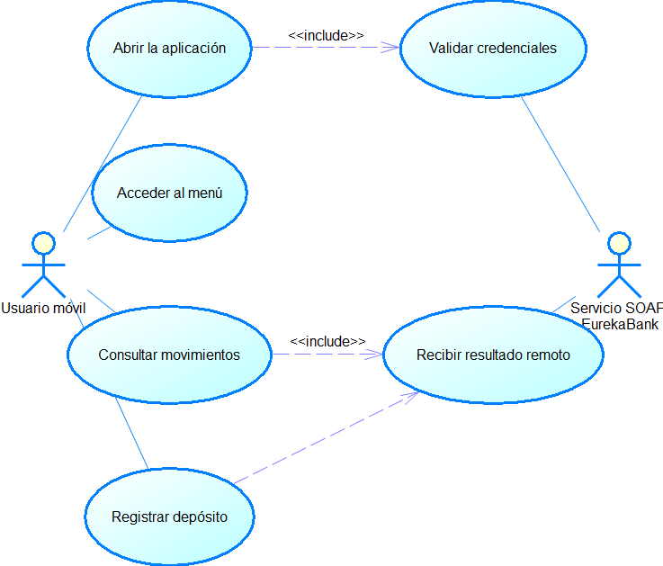

---
lang: es
---

```{=openxml}
<w:p><w:r><w:br w:type="page"/></w:r></w:p>
```

```{=openxml}
<w:p><w:pPr><w:pStyle w:val="TtuloTDC"/></w:pPr><w:r><w:t>ÍNDICE DE TABLAS</w:t></w:r></w:p>
<w:p><w:r><w:fldChar w:fldCharType="begin"/></w:r><w:r><w:instrText xml:space="preserve"> TOC \h \z \c "Table" </w:instrText></w:r><w:r><w:fldChar w:fldCharType="separate"/></w:r><w:r><w:t>Actualizar índice de tablas</w:t></w:r><w:r><w:fldChar w:fldCharType="end"/></w:r></w:p>
<w:p><w:pPr><w:pStyle w:val="TtuloTDC"/></w:pPr><w:r><w:t>ÍNDICE DE ILUSTRACIONES</w:t></w:r></w:p>
<w:p><w:r><w:fldChar w:fldCharType="begin"/></w:r><w:r><w:instrText xml:space="preserve"> TOC \h \z \c "Figure" </w:instrText></w:r><w:r><w:fldChar w:fldCharType="separate"/></w:r><w:r><w:t>Actualizar índice de ilustraciones</w:t></w:r><w:r><w:fldChar w:fldCharType="end"/></w:r></w:p>
<w:p><w:r><w:br w:type="page"/></w:r></w:p>
```

# Caso de estudio {.unnumbered}

El proyecto móvil EurekaBank contiene recursos Android para un ingreso y un menú, además de adaptadores Java que forman solicitudes SOAP de login, consulta de movimientos y depósito con kSOAP. La aplicación solicita permiso de Internet y permite HTTP sin cifrado para la dirección fija del servicio. Sin embargo, el manifiesto declara actividades cuya implementación Java no está presente en el árbol revisado; las opciones del menú apuntan a actividades que tampoco están incluidas. Por ello, los adaptadores y las pantallas no conforman todavía un flujo móvil ejecutable completo.

Esta especificación registra la línea base parcial y define los requisitos de integración que deben satisfacerse para aceptar el cliente. El diagrama distingue las funciones pretendidas por los recursos y adaptadores de las brechas que impiden acreditar su ejecución desde la interfaz.

: Tabla 1. Dato y Valor

| Dato | Valor |
|---|---|
| Proyecto | EurekaBank SOAP Java, cliente Android |
| Equipo | Grupo 1 |
| Versión del ERS | 1.0 |
| Fecha de la línea base | 21 de octubre de 2026 |
| Estado | Implementación parcial; aceptación pendiente |

# 1 Introducción

Este documento define requisitos para completar y validar el cliente Android EurekaBank. Está dirigido al equipo que mantiene la aplicación móvil, al responsable de integrar el servicio SOAP y a quien prepara el entorno de Payara Server Community 7. El código disponible aporta un menú Android, diseños de pantalla y adaptadores kSOAP, pero no acredita el recorrido completo entre la pantalla inicial, la autenticación, las operaciones y su presentación al usuario.

La dirección del endpoint está codificada en las clases del cliente. Una operación de movimientos y otra de depósito usan un timeout de 60 segundos y habilitan volcados de solicitud y respuesta. El login usa el transporte sin configurar un timeout explícito. La aplicación debe mantener compatibilidad con el contrato del servicio desplegado en Payara y evitar que los mensajes SOAP y credenciales queden expuestos en registros.

# 2 Propósito

El propósito es convertir los recursos y adaptadores existentes en una línea base de requisitos comprobables, identificar brechas de implementación y fijar condiciones de aceptación para una aplicación Android funcional. Los requisitos marcados como pendientes no se deben presentar como funciones ya operativas.

# 3 Alcance

El alcance contempla inicio, autenticación, menú, consulta de movimientos, registro de depósito, presentación de respuestas y comunicación SOAP. El servicio central EurekaBank se considera desplegado en Payara Server Community 7. Android es el entorno del cliente y no se despliega en Payara.

No se documentan como disponibles pagos, transferencias, retiros, administración de cuentas ni persistencia local de datos bancarios. Tampoco se acredita autenticación por cada operación, cifrado HTTPS, renovación de sesión, almacenamiento seguro de credenciales, operación sin conexión ni reintento idempotente. La versión revisada apunta a una dirección privada fija y requiere configuración por ambiente antes de distribuirse.

: Tabla 2. Función y Línea base encontrada

| Función | Línea base encontrada | Estado para aceptación |
|---|---|---|
| Pantalla de ingreso | Existe un recurso XML con campos de usuario, contraseña y botón | Parcial; no se encontró Activity Java que lo controle |
| Menú | Existe Activity Menu con dos botones | Parcial; sus destinos no están en el código disponible |
| Login SOAP | Existe WSLoginClient basado en kSOAP | Adaptador presente; integración con la pantalla no acreditada |
| Movimientos SOAP | Existe WSEurekabankCliente.traerMovimientos | Adaptador presente; presentación móvil no acreditada |
| Depósito SOAP | Existe WSEurekabankCliente.regDeposito | Adaptador presente; formulario y resultado no acreditados |

# 4 Definiciones acrónimos y abreviaturas

: Tabla 3. Término y Definición

| Término | Definición |
|---|---|
| Activity | Pantalla Android administrada por el ciclo de vida de la aplicación |
| kSOAP | Biblioteca empleada para construir y consumir mensajes SOAP en Android |
| SOAP | Protocolo de intercambio XML con el servicio EurekaBank |
| Endpoint | Dirección de red donde Payara publica el servicio SOAP |
| Resultado incierto | Respuesta no recibida después de enviar una operación bancaria |
| HTTP | Transporte actual configurado para el endpoint del proyecto |

# 5 Referencias del código

: Tabla 4. M1 AndroidManifest.xml

| ID | Fuente | Evidencia funcional |
|---|---|---|
| M1 | AndroidManifest.xml | Permiso Internet, actividades declaradas y configuración de red |
| M2 | Menu.java y activity_menu.xml | Presentación del menú y navegación a actividades |
| M3 | activity_main.xml | Diseño de campos de ingreso y botón |
| M4 | WSLoginClient.java | Solicitud SOAP login y cadena de resultado/error |
| M5 | WSEurekabankCliente.java | Solicitudes SOAP de movimientos y depósito |
| M6 | Movimiento.java | Datos locales para representar un movimiento |
| M7 | build.gradle | SDK Android, Java 8, kSOAP y bibliotecas de interfaz |

# 6 Visión general del documento

Las primeras secciones fijan el objetivo, alcance, usuarios y arquitectura. La especificación detalla las pantallas y las operaciones remotas, con su estado actual. Las secciones finales indican requisitos de seguridad, conectividad, compatibilidad y pruebas de aceptación necesarias para completar el flujo en un dispositivo o emulador.

# 7 Descripción general

## 7.1 Perspectiva del producto

El cliente móvil se compone de una aplicación Android y adaptadores SOAP. El menú usa intents para navegar. Los adaptadores construyen solicitudes kSOAP dirigidas a una dirección fija y convierten respuestas XML a cadenas u objetos Movimiento. El backend debe mantenerse en Payara Server Community 7 con el WSDL compatible.

: Tabla 5. Componente y Responsabilidad observada

| Componente | Responsabilidad observada |
|---|---|
| Usuario móvil | Proporciona credenciales, cuenta e importe |
| Actividad Menu | Muestra botones para depósito y movimientos |
| Cliente de login | Construye e invoca login con kSOAP |
| Cliente EurekaBank | Invoca traerMovimientos y regDeposito |
| Servicio remoto | Procesa operaciones bajo el contrato publicado en Payara 7 |
| Android | Aloja la interfaz y requiere permiso de Internet |

## 7.2 Funciones previstas

: Tabla 6. Función y Datos

| Función | Datos | Resultado esperado |
|---|---|---|
| Iniciar sesión | usuario, contraseña | Acceso al menú o mensaje de rechazo |
| Consultar movimientos | cuenta | Lista legible con los campos de movimiento |
| Registrar depósito | cuenta e importe | Confirmación o rechazo sin duplicar la operación |
| Navegar | selección en el menú | Apertura de la pantalla correspondiente |

La tabla resume el comportamiento que debe completarse. El repositorio contiene el adaptador y recursos asociados, pero no todas las Activities que conectarían estos elementos.

## 7.3 Usuarios y entorno

El usuario previsto es un operador en un teléfono o emulador Android con acceso a la red del servicio. El proyecto declara compileSdk 34, targetSdk 34, minSdk 27 y compatibilidad de fuente/bytecode Java 8. La aplicación debe alcanzar un endpoint configurado para el ambiente y el servicio debe ejecutarse en Payara Server Community 7.

## 7.4 Restricciones y dependencias

El manifiesto permite tráfico HTTP claro para el host privado configurado y no acredita transporte cifrado. Las direcciones IP no deben quedar fijadas para una versión distribuible. Las clases de servicio activan el modo debug de kSOAP para llamadas de movimientos y depósito e imprimen volcados de SOAP. La revisión de seguridad debe desactivar esos volcados y acordar HTTPS para entornos fuera de laboratorio.

: Tabla 7. Restricción y Consecuencia

| Restricción | Consecuencia |
|---|---|
| Dirección de servicio codificada | Cambiar de red requiere modificar y reconstruir la app |
| HTTP sin cifrado | Credenciales y datos pueden exponerse en tránsito |
| Clases de Activity ausentes | La navegación declarada no acredita un flujo ejecutable |
| Manejo de error con cadenas o null | La interfaz necesita normalizar resultados antes de mostrarlos |
| Timeout distinto por operación | Las esperas deben definirse y probarse de forma coherente |

# 8 Especificación de requisitos

## 8.1 Interfaces externas

: Tabla 8. Interfaz y Intercambio

| Interfaz | Intercambio |
|---|---|
| Pantalla de ingreso | Usuario, contraseña y acción de inicio |
| Pantalla de menú | Selección de consulta, depósito o salida |
| SOAP login | usuario y contrasena; respuesta textual interpretada por el cliente |
| SOAP traerMovimientos | cuenta; registros con cuenta, número, fecha, tipo, acción e importe |
| SOAP regDeposito | cuenta e importe; respuesta interpretada como resultado |
| Payara a base de datos | Persistencia central a cargo del servicio, fuera del cliente Android |

## 8.2 Objetivos y actores

: Tabla 9. OBJ-01 Permitir que el operador acceda al servicio bancario desde Android

| ID | Objetivo |
|---|---|
| OBJ-01 | Permitir que el operador acceda al servicio bancario desde Android |
| OBJ-02 | Presentar movimientos de una cuenta en una pantalla móvil |
| OBJ-03 | Solicitar un depósito y mostrar una respuesta inequívoca |
| OBJ-04 | Mantener el contrato del servidor Payara y las respuestas SOAP |

: Tabla 10. Actor y Participación

| Actor | Participación |
|---|---|
| Usuario móvil | Inicia sesión, navega y solicita operaciones |
| Servicio SOAP EurekaBank | Valida y devuelve resultados al cliente |

## 8.3 Casos de uso

{width=14cm}

: Tabla 11. Caso y Precondición

| Caso | Precondición | Resultado esperado y estado |
|---|---|---|
| CU-01 Iniciar sesión | Aplicación abierta y endpoint alcanzable | Valida credenciales y muestra menú; Activity pendiente de integrar |
| CU-02 Abrir menú | Inicio de sesión aceptado | Presenta consulta y depósito; Activity presente con destinos ausentes |
| CU-03 Consultar movimientos | Sesión local aceptada y cuenta ingresada | Adaptador obtiene lista; vista y ejecución asíncrona pendientes |
| CU-04 Registrar depósito | Sesión local aceptada y datos válidos | Adaptador envía cuenta e importe; formulario y resultado pendientes |
| CU-05 Mostrar resultado remoto | Respuesta o error recibido | Convierte respuesta, rechazo y error de transporte en mensajes distintos |

## 8.4 Requisitos funcionales

: Tabla 12. RF-01 Presentar ingreso, recibir credenciales e invocar login

| ID | Requisito | Prioridad | Estado |
|---|---|---|---|
| RF-01 | Presentar ingreso, recibir credenciales e invocar login | Alta | Parcial; pantalla y adaptador separados |
| RF-02 | Mostrar menú y navegar a consulta y depósito | Alta | Parcial; las Activities destino no están disponibles |
| RF-03 | Consultar movimientos y presentarlos en Android | Alta | Parcial; adaptador presente, vista ausente |
| RF-04 | Validar datos, registrar depósito y presentar su resultado | Alta | Parcial; adaptador presente, flujo de UI ausente |
| RF-05 | Informar errores SOAP y conectividad sin confundirlos con rechazo | Alta | Pendiente de integración |
| RF-06 | Permitir salir o finalizar el acceso local | Media | Pendiente; no se encontró flujo de autenticación integrado |

### Fichas de requisitos funcionales

: Tabla 13. RF-01 Autenticación móvil

| Campo | RF-01 Autenticación móvil |
|---|---|
| Descripción | La aplicación deberá tomar usuario y contraseña del formulario Android y llamar login mediante kSOAP. |
| Criterio de aceptación | Una respuesta válida abre el menú; credenciales rechazadas y fallos de transporte muestran estados distintos. |
| Trazabilidad | CU-01; M3, M4 |
| Estado | Parcial: recursos y adaptador existen, falta la Activity que los conecta. |

: Tabla 14. RF-02 Navegación móvil

| Campo | RF-02 Navegación móvil |
|---|---|
| Descripción | El menú deberá abrir la pantalla disponible para cada función, conservando el estado local requerido. |
| Criterio de aceptación | Ambos destinos están declarados, compilados y se pueden abrir desde la actividad principal. |
| Trazabilidad | CU-02; M1, M2 |
| Estado | Parcial: Menu apunta a clases no encontradas en las fuentes revisadas. |

: Tabla 15. RF-03 Consulta móvil

| Campo | RF-03 Consulta móvil |
|---|---|
| Descripción | La vista de movimientos deberá llamar traerMovimientos y mostrar cada registro con fecha y monto legibles. |
| Criterio de aceptación | Lista vacía, lista con datos, respuesta inválida y error de servicio presentan estados claros. |
| Trazabilidad | CU-03; M5, M6 |
| Estado | Parcial: conversión kSOAP implementada; pantalla y tarea fuera del hilo principal no acreditadas. |

: Tabla 16. RF-04 Depósito móvil

| Campo | RF-04 Depósito móvil |
|---|---|
| Descripción | La vista deberá validar cuenta e importe antes de llamar regDeposito. |
| Criterio de aceptación | Solo la confirmación remota válida se presenta como depósito aplicado; rechazo y error no se confunden. |
| Trazabilidad | CU-04; M5 |
| Estado | Parcial: adaptador presente, formulario conectado ausente. |

: Tabla 17. RF-05 Errores y respuestas

| Campo | RF-05 Errores y respuestas |
|---|---|
| Descripción | El cliente distinguirá rechazo funcional, falta de registros, error SOAP y respuesta incierta. |
| Criterio de aceptación | Los mensajes no instruyen repetir un depósito cuando no se conoce el resultado remoto. |
| Trazabilidad | CU-05; M4, M5 |
| Estado | Pendiente de una capa de presentación integrada. |

## 8.5 Reglas de negocio y datos

: Tabla 18. RN-01 Las credenciales se envían solo al login; el contrato actual no establece un token remoto para las demás operaciones.

| ID | Regla |
|---|---|
| RN-01 | Las credenciales se envían solo al login; el contrato actual no establece un token remoto para las demás operaciones. |
| RN-02 | El servicio es responsable de aceptar o rechazar cuenta e importe. |
| RN-03 | El valor retornado por el servidor debe distinguirse de una falla de transporte. |
| RN-04 | Una respuesta nula de consulta no debe convertirse silenciosamente en una lista bancaria confirmada. |
| RN-05 | El cliente no debe reintentar automáticamente un depósito sin idempotencia. |

: Tabla 19. Dato y Representación observada

| Dato | Representación observada |
|---|---|
| usuario y contraseña | Propiedades SOAP de login |
| cuenta | Texto enviado para consulta o depósito |
| importe | Texto en la solicitud móvil de depósito |
| Movimiento | Cuenta, número, fecha, tipo, acción e importe |
| resultado/error | Cadena devuelta por el cliente de login o depósito |

# 9 Requisitos no funcionales

: Tabla 20. RNF-01 Seguridad del transporte Credenciales y datos bancarios deben viajar cifrados en ambientes no aislados

| ID | Requisito | Estado y criterio de revisión |
|---|---|---|
| RNF-01 Seguridad del transporte | Credenciales y datos bancarios deben viajar cifrados en ambientes no aislados | HTTPS y certificado válido; la línea base usa HTTP |
| RNF-02 Protección de registros | Los volcados de solicitud y respuesta no deben contener secretos en builds de entrega | Desactivar debug y revisar Logcat |
| RNF-03 Compatibilidad | La app debe ejecutarse desde minSdk 27 hasta el SDK objetivo declarado | Compilar e instalar en dispositivos representativos |
| RNF-04 Interoperabilidad | Las solicitudes deben ajustarse al WSDL servido por Payara 7 | Verificar namespace, acción, tipos y endpoint |
| RNF-05 Responsividad | La red no debe bloquear el hilo principal | Implementar y revisar ejecución asíncrona antes de aceptar |
| RNF-06 Disponibilidad | La app debe informar indisponibilidad del servidor sin perder datos ingresados | Pruebas controladas de conexión y timeout |
| RNF-07 Mantenibilidad | URL, timeout y modo debug deben configurarse por ambiente | Revisar configuración de build y manifiesto |

## 9.1 Restricciones calidad y rendimiento

No hay resultados de carga ni mediciones de uso de memoria. Los adaptadores de consulta y depósito fijan 60 segundos, mientras el login no declara el mismo límite. La lista de movimientos se convierte completa en memoria. Antes de acordar un nivel de servicio se deben medir el contrato desplegado en Payara, el dispositivo, la red y el tamaño del historial.

: Tabla 21. Escenario y Evidencia necesaria

| Escenario | Evidencia necesaria |
|---|---|
| Inicio aceptado y rechazado | Respuesta y navegación observadas en dispositivo |
| Consulta vacía, pequeña y grande | Contenido, orden, memoria y tiempo de respuesta |
| Depósito rechazado y confirmado | Respuesta y estado persistido confirmado posteriormente |
| Error de conexión y timeout | Mensaje, conservación de datos y ausencia de repetición automática |
| Rotación o retorno de actividad | Estado coherente sin duplicar solicitudes |

# Trazabilidad y aceptación

: Tabla 22. Caso y Requisitos

| Caso | Requisitos | Componentes |
|---|---|---|
| CU-01 | RF-01, RF-05, RNF-01, RNF-02 | Pantalla de ingreso, WSLoginClient |
| CU-02 | RF-02, RNF-03 | Menu, Activities destino |
| CU-03 | RF-03, RF-05, RNF-04, RNF-05 | WSEurekabankCliente, Movimiento, vista móvil |
| CU-04 | RF-04, RF-05, RNF-01, RNF-05 | WSEurekabankCliente, formulario móvil |
| CU-05 | RF-05, RNF-06, RNF-07 | Adaptadores SOAP y presentación |

La aceptación requiere completar las Activities faltantes, conectar las vistas con los adaptadores, fijar la URL del servicio para Payara 7 por ambiente, desactivar logs SOAP sensibles y demostrar cada flujo en Android. No se deben considerar cumplidos RF-01 a RF-04 mediante la sola existencia de clases cliente.

# Recomendaciones

Completar las Activities declaradas y las dos pantallas destino; ejecutar las llamadas remotas fuera del hilo principal; mantener URL y timeout por entorno; usar HTTPS para cualquier red que no sea aislada; desactivar los volcados SOAP; validar y normalizar respuesta, `null` y excepciones; y añadir un mecanismo de correlación antes de plantear reintentos de depósito.

# Conclusiones

El repositorio móvil contiene un punto de partida útil: layouts, menú, permiso de red y adaptadores SOAP. Las fuentes revisadas no conectan esos elementos en un cliente Android completo. Este ERS deja esa brecha explícita, define el comportamiento requerido y vincula la aceptación con evidencias de interfaz y del servicio Payara.

# Bibliografía y fuentes técnicas

Las fuentes técnicas son AndroidManifest.xml, las Activities y layouts disponibles, los adaptadores kSOAP, el modelo Movimiento y los manifiestos Gradle del cliente. El contrato y endpoint deben cotejarse con la instancia EurekaBank desplegada en Payara Server Community 7 para el ambiente de destino.