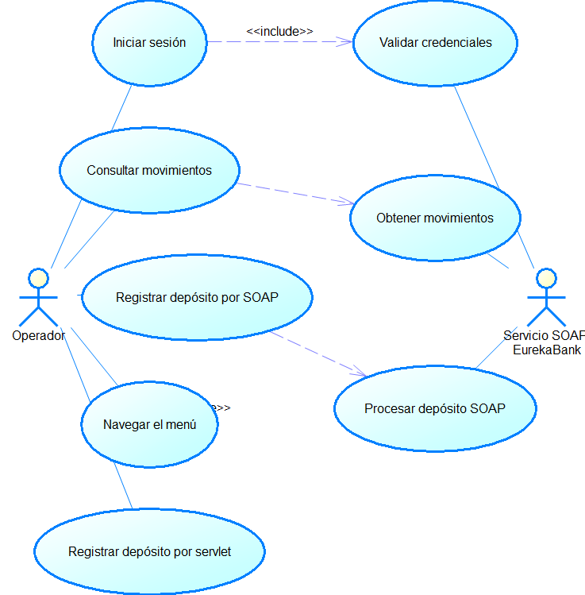

---
lang: es
---

```{=openxml}
<w:p><w:r><w:br w:type="page"/></w:r></w:p>
```

```{=openxml}
<w:p><w:pPr><w:pStyle w:val="TtuloTDC"/></w:pPr><w:r><w:t>ÍNDICE DE TABLAS</w:t></w:r></w:p>
<w:p><w:r><w:fldChar w:fldCharType="begin"/></w:r><w:r><w:instrText xml:space="preserve"> TOC \h \z \c "Table" </w:instrText></w:r><w:r><w:t>Actualizar índice de tablas</w:t></w:r><w:r><w:fldChar w:fldCharType="end"/></w:r></w:p>
<w:p><w:pPr><w:pStyle w:val="TtuloTDC"/></w:pPr><w:r><w:t>ÍNDICE DE ILUSTRACIONES</w:t></w:r></w:p>
<w:p><w:r><w:fldChar w:fldCharType="begin"/></w:r><w:r><w:instrText xml:space="preserve"> TOC \h \z \c "Figure" </w:instrText></w:r><w:r><w:fldChar w:fldCharType="separate"/></w:r><w:r><w:t>Actualizar índice de ilustraciones</w:t></w:r><w:r><w:fldChar w:fldCharType="end"/></w:r></w:p>
<w:p><w:r><w:br w:type="page"/></w:r></w:p>
```

# Caso de estudio {.unnumbered}

El cliente web de EurekaBank presenta páginas para iniciar sesión, abrir un menú, consultar movimientos y registrar un depósito. Las páginas de consulta y depósito construyen mensajes SOAP desde JavaScript y llaman una dirección fija del servicio. El proyecto también contiene un servlet y clases JDBC para una ruta de depósito directa que inserta datos en una tabla separada. Esa ruta no realiza la misma actualización bancaria que el servicio SOAP y debe mantenerse diferenciada.

La solución requiere un servidor Payara Server Community 7 para alojar el servicio SOAP y el WAR web. El código web usa APIs `javax.servlet`; antes de desplegarlo en Payara 7 se debe alinear el código y las dependencias con las APIs compatibles de esa versión. La especificación separa las funciones visibles, las rutas de servicio y las brechas de seguridad que impiden considerar la versión lista para producción.

: Tabla 1. Dato y Valor

| Dato | Valor |
|---|---|
| Proyecto | EurekaBank SOAP Java, cliente web |
| Equipo | Grupo 1 |
| Versión del ERS | 1.0 |
| Fecha de la línea base | 21 de octubre de 2026 |
| Estado | Requisitos basados en páginas y código Java disponibles |

# 1 Introducción

Este ERS define el comportamiento observable y las interfaces del cliente web EurekaBank. Se dirige al equipo que mantiene las páginas, al responsable del WAR y a quienes despliegan el servicio en Payara Server Community 7. La línea base incluye navegación entre páginas, solicitudes SOAP desde el navegador y un endpoint de servlet con acceso JDBC directo.

La versión actual no conserva un token o sesión de usuario entre login y operaciones. El endpoint SOAP está codificado en las páginas como una dirección HTTP privada. El navegador debe permitir la comunicación entre orígenes y la política del servicio debe aceptarla; el proyecto no acredita una pasarela de servidor que resuelva CORS. La operación de depósito tiene además dos rutas con persistencia distinta, por lo que el contrato y el resultado deben asociarse explícitamente al camino ejecutado.

# 2 Propósito

El propósito es especificar los requisitos de la interfaz web existente, definir la integración correcta con EurekaBank y señalar los controles necesarios para que credenciales y transacciones se gestionen de forma verificable en Payara. El documento no declara compatible o productivo el módulo servlet sin una validación de APIs, transporte y seguridad.

# 3 Alcance

El alcance comprende páginas HTML/JavaScript, navegación, autenticación SOAP, consulta de movimientos, depósito SOAP y el servlet incluido. El servicio central y cualquier módulo web se deben desplegar exclusivamente en Payara Server Community 7. El navegador accede a páginas alojadas por el WAR y, en la línea base, invoca el servicio SOAP directamente.

Quedan fuera transferencias, retiros, administración de usuarios, autorización por roles, paginación, recuperación de contraseña, administración de cuentas, auditoría formal y protección de sesión persistente. La ruta `DepositoServlet` se documenta como código disponible separado; su sentencia de inserción en la tabla `deposito` no prueba que se actualice saldo y movimiento como el contrato SOAP.

: Tabla 2. Función y Implementación observada

| Función | Implementación observada | Límite principal |
|---|---|---|
| Inicio de sesión | JavaScript envía login SOAP y navega al menú si lee resultado 1 | No mantiene una sesión o token remoto |
| Menú | Botones enlazan páginas de movimientos y depósito | No protege el acceso a las páginas |
| Consulta | JavaScript llama traerMovimientos y crea filas HTML | URL fija, errores solo en consola y salida insertada con innerHTML |
| Depósito SOAP | Formulario compone una solicitud regDeposito | Debe verificarse la acción SOAP y compatibilidad de parámetros |
| Depósito servlet | Servlet acepta POST y servicio JDBC inserta una fila | Ruta distinta, sin la transacción bancaria del servicio remoto |

# 4 Definiciones acrónimos y abreviaturas

: Tabla 3. Término y Definición

| Término | Definición |
|---|---|
| WAR | Archivo de aplicación web Java desplegable en Payara |
| SOAP | Protocolo XML usado para comunicar el navegador con EurekaBank |
| WSDL | Contrato de operaciones y tipos publicado por el servicio |
| CORS | Política que controla solicitudes del navegador a otro origen |
| Servlet | Componente Java que procesa solicitudes HTTP dentro del WAR |
| Resultado incierto | Solicitud enviada cuya respuesta no permite conocer el estado remoto |

# 5 Referencias del código

: Tabla 4. W1 index.html

| ID | Fuente | Responsabilidad |
|---|---|---|
| W1 | index.html | Formulario de credenciales y llamada SOAP login |
| W2 | Menu.html | Navegación a consulta y depósito |
| W3 | Movimientos.html | Solicitud traerMovimientos y presentación de tabla |
| W4 | Depositos.html y realizar_depositos.js | Formularios y llamadas de depósito disponibles en el proyecto |
| W5 | DepositoServlet.java | Endpoint HTTP del depósito alternativo |
| W6 | EurekaControlador.java y EurekaService.java | Adaptación del servlet a la ruta JDBC local |
| W7 | AccesoDB.java | Configuración JDBC local incluida en el módulo web |
| W8 | WSEureka.wsdl | Referencia SOAP incluida para consumo |
| W9 | glassfish-web.xml y manifiestos de NetBeans | Configuración de empaquetado web; destino de ejecución requerido Payara 7 |

# 6 Visión general del documento

Las secciones 1 a 7 describen contexto, alcance y arquitectura. La sección 8 especifica las interfaces y requisitos funcionales. La sección 9 establece requisitos no funcionales de seguridad, compatibilidad y rendimiento. Trazabilidad y aceptación conectan cada caso con los componentes y las evidencias esperadas.

# 7 Descripción general

## 7.1 Perspectiva del producto

El módulo presenta contenido web alojado en un WAR. El navegador ejecuta JavaScript y se comunica con el servicio SOAP EurekaBank. En paralelo, el WAR registra un servlet que delega a clases con JDBC directo. Esta segunda ruta debe aislarse o integrarse de forma coherente para que una misma intención del usuario no use reglas de negocio diferentes.

: Tabla 5. Componente y Responsabilidad

| Componente | Responsabilidad |
|---|---|
| Operador | Proporciona credenciales y datos de cuenta |
| Página de ingreso | Invoca login y muestra rechazo o navegación |
| Página de menú | Enlaza páginas de movimientos y depósito |
| JavaScript web | Construye XML SOAP y presenta la respuesta |
| Servicio SOAP | Procesa operaciones bancarias y se ejecuta en Payara 7 |
| WAR y servlet | Alojan páginas y ofrecen una ruta HTTP adicional |
| MySQL | Persistencia a través del servicio SOAP o ruta JDBC alternativa |

## 7.2 Funciones del producto

: Tabla 6. Función y Entradas

| Función | Entradas | Resultado esperado |
|---|---|---|
| Login | Usuario y contraseña | Aceptar y abrir menú o mostrar rechazo |
| Consulta | Número de cuenta | Presentar movimientos o lista vacía |
| Depósito por SOAP | Cuenta, importe y los parámetros acordados en WSDL | Mostrar resultado funcional o error de comunicación |
| Navegación | Acción de menú | Abrir página seleccionada |
| Depósito por servlet | Cuenta e importe HTTP | Requiere definición y validación; no se equipara a depósito bancario SOAP |

## 7.3 Usuarios y entorno

El usuario es un operador con un navegador moderno. La aplicación web debe ejecutarse desde un WAR compatible con Payara Server Community 7. El servicio SOAP EurekaBank también debe estar disponible en Payara 7 con el contrato accesible y MySQL configurado en el servidor. El navegador requiere conectividad con el origen del servicio y políticas CORS alineadas.

## 7.4 Restricciones y dependencias

Las páginas apuntan a una IP privada, usan HTTP y construyen XML mediante interpolación de cadenas. La consulta añade los valores recuperados al DOM a través de `innerHTML`. Estos mecanismos requieren validación y escape para evitar errores de entorno y contenido inyectado. La implementación Servlet usa `javax.servlet`; el despliegue en Payara 7 exige verificar las dependencias Jakarta compatibles y adaptar los imports si el runtime no soporta ese espacio de nombres.

: Tabla 7. Restricción y Efecto

| Restricción | Efecto |
|---|---|
| Endpoint HTTP codificado | La aplicación no se configura por ambiente |
| Solicitudes directas desde el navegador | Dependen de CORS y exponen el endpoint al cliente |
| Login sin estado persistido | Se puede abrir una página de operación sin sesión válida |
| Ruta servlet con conexión propia | Diverge del servicio SOAP y de sus reglas transaccionales |
| `javax.servlet` en código | Requiere compatibilidad de API antes del despliegue en Payara 7 |

# 8 Especificación de requisitos

## 8.1 Interfaces externas

: Tabla 8. Interfaz y Solicitud y respuesta

| Interfaz | Solicitud y respuesta |
|---|---|
| Navegador y WAR | Páginas HTML, JavaScript, formularios y respuestas |
| SOAP login | usuario, contrasena y respuesta entera |
| SOAP traerMovimientos | cuenta y colección de registros de movimiento |
| SOAP regDeposito | Cuenta e importe; parámetros deben alinearse al WSDL |
| Servlet /DepositoServlet | Parámetros HTTP de cuenta e importe; página de resultado |
| WAR y Payara 7 | Despliegue y ciclo de vida de las páginas y servlets |
| Payara y MySQL | Acceso configurado por el servicio; ruta JDBC alternativa heredada requiere revisión |

La página de ingreso deja SOAPAction vacío y las páginas de operaciones forman acciones propias. El endpoint se fija en el código. Antes de aceptar una publicación se debe cotejar cada acción, namespace y parámetro con el WSDL desplegado en Payara 7. El formulario SOAP de depósito incluye `tipoCodigo`, y el método Java del servlet usa otro contrato; no se debe inferir que ambas rutas son intercambiables.

## 8.2 Objetivos y actores

: Tabla 9. OBJ-01 Dar al operador una interfaz web para autenticarse y navegar

| ID | Objetivo |
|---|---|
| OBJ-01 | Dar al operador una interfaz web para autenticarse y navegar |
| OBJ-02 | Presentar los movimientos de una cuenta consultada |
| OBJ-03 | Solicitar un depósito con confirmación verificable |
| OBJ-04 | Mantener publicación y procesamiento en Payara Server Community 7 |

: Tabla 10. Actor y Participación

| Actor | Participación |
|---|---|
| Operador web | Inicia sesión, consulta y solicita un depósito |
| Servicio SOAP EurekaBank | Valida y procesa las llamadas SOAP |
| Responsable de despliegue | Publica el WAR y el servicio en Payara 7 |

## 8.3 Casos de uso

{width=14cm}

: Tabla 11. Caso y Precondición

| Caso | Precondición | Resultado |
|---|---|---|
| CU-01 Iniciar sesión | WAR y servicio alcanzables | Login aceptado lleva al menú; un rechazo se informa sin abrirlo |
| CU-02 Navegar operaciones | Menú visible | Abre consulta o depósito |
| CU-03 Consultar movimientos | Cuenta ingresada y endpoint activo | Presenta una tabla o lista vacía, distinguiendo error de transporte |
| CU-04 Registrar depósito SOAP | Datos válidos y servicio activo | Muestra confirmación solo si la respuesta contractual confirma el resultado |
| CU-05 Registrar depósito servlet | Ruta Servlet disponible y datos validados | Debe devolver resultado coherente; no se acepta como equivalente bancario sin actualización de cuenta y movimiento |

## 8.4 Requisitos funcionales

: Tabla 12. RF-01 Recibir credenciales e invocar login SOAP

| ID | Requisito | Prioridad | Estado |
|---|---|---|---|
| RF-01 | Recibir credenciales e invocar login SOAP | Alta | Implementado en página |
| RF-02 | Habilitar navegación tras login aceptado | Alta | Implementado solo como redirección local |
| RF-03 | Consultar movimientos y presentar el resultado | Alta | Implementado con errores parciales |
| RF-04 | Enviar depósito SOAP y distinguir confirmación y rechazo | Alta | Implementación presente; contrato debe cotejarse |
| RF-05 | Validar entrada y proteger salida HTML | Alta | Pendiente de endurecimiento |
| RF-06 | Uniformar o retirar la ruta servlet-JDBC adicional | Alta | Pendiente de decisión y validación |

### Fichas de requisitos funcionales

: Tabla 13. RF-01 Autenticación web

| Campo | RF-01 Autenticación web |
|---|---|
| Descripción | La página enviará usuario y contraseña a login por el endpoint SOAP configurado. |
| Criterio de aceptación | Resultado 1 navega al menú; rechazo, error HTTP y error de análisis se muestran por separado. |
| Trazabilidad | CU-01; W1, W8 |
| Observación | No existe una sesión autenticada compartida con las operaciones posteriores. |

: Tabla 14. RF-02 Navegación

| Campo | RF-02 Navegación |
|---|---|
| Descripción | El menú permitirá abrir movimientos y depósito. |
| Criterio de aceptación | Cada enlace abre la vista correspondiente, y la aplicación conserva un mecanismo de control de acceso definido. |
| Trazabilidad | CU-02; W2 |
| Observación | La navegación actual es del lado del navegador y no comprueba autorización. |

: Tabla 15. RF-03 Consulta

| Campo | RF-03 Consulta |
|---|---|
| Descripción | El cliente enviará la cuenta a traerMovimientos y representará las propiedades de cada registro. |
| Criterio de aceptación | Lista vacía, resultado válido, respuesta SOAP inválida y error de red generan estados distinguibles. |
| Trazabilidad | CU-03; W3, W8 |
| Observación | Los datos no deben insertarse con innerHTML sin escape. No se ofrece paginación. |

: Tabla 16. RF-04 Depósito SOAP

| Campo | RF-04 Depósito SOAP |
|---|---|
| Descripción | El formulario enviará solo los parámetros definidos en el WSDL y presentará la respuesta de regDeposito. |
| Criterio de aceptación | La confirmación exige respuesta válida; rechazo y error de red no se muestran como depósito aplicado. |
| Trazabilidad | CU-04; W4, W8 |
| Observación | El campo tipoCodigo y el SOAPAction deben cotejarse con el contrato activo antes de considerar el flujo interoperable. |

: Tabla 17. RF-05 Validación y presentación

| Campo | RF-05 Validación y presentación |
|---|---|
| Descripción | Las páginas validarán cuenta, importe y contenido XML, y mostrarán mensajes sin evaluar datos remotos como HTML. |
| Criterio de aceptación | Valores vacíos, inválidos o malformados no se envían y los datos de respuesta se representan como texto seguro. |
| Trazabilidad | CU-03, CU-04; W3, W4 |
| Estado | Pendiente de integración y revisión de seguridad. |

: Tabla 18. RF-06 Ruta de depósito servlet

| Campo | RF-06 Ruta de depósito servlet |
|---|---|
| Descripción | La ruta alternativa deberá retirarse o alinearse con la misma regla bancaria del servicio SOAP. |
| Criterio de aceptación | No puede confirmar una operación si solo insertó una fila local y no actualizó la cuenta y el movimiento de forma atómica. |
| Trazabilidad | CU-05; W5, W6, W7 |
| Observación | El código disponible hace un INSERT JDBC en `deposito`, separado de regDeposito. |

## 8.5 Reglas de negocio y datos

: Tabla 19. RN-01 Solo una respuesta contractual de login aceptada permite presentar el menú como acceso logrado.

| ID | Regla |
|---|---|
| RN-01 | Solo una respuesta contractual de login aceptada permite presentar el menú como acceso logrado. |
| RN-02 | Abrir una página directamente no equivale a una autenticación válida. |
| RN-03 | Un depósito confirmado requiere respuesta válida del servicio y verificación de persistencia durante la aceptación. |
| RN-04 | El depósito directo por servlet no se debe sumar al saldo bancario salvo que aplique las mismas reglas y transacción. |
| RN-05 | Los datos XML mostrados deben tratarse como texto no confiable. |

: Tabla 20. Dato y Uso

| Dato | Uso |
|---|---|
| usuario y contraseña | Parámetros de login SOAP |
| cuenta | Filtro de consulta o cuenta de depósito |
| importe | Monto del formulario SOAP o del servlet |
| movimiento | Cuenta, número, fecha, tipo, acción e importe |
| resultado | Valor contractual retornado por el servicio remoto |

# 9 Requisitos no funcionales

: Tabla 21. RNF-01 Transporte HTTPS debe proteger credenciales y datos bancarios

| ID | Requisito | Estado y criterio de revisión |
|---|---|---|
| RNF-01 Transporte | HTTPS debe proteger credenciales y datos bancarios | Pendiente; la dirección actual usa HTTP |
| RNF-02 Seguridad de sesión | Operaciones deben vincularse a usuario autorizado | Pendiente; no se transmite token ni estado de servidor |
| RNF-03 Protección contra inyección | Respuestas XML y entradas deben escaparse y validarse | Pendiente; se utiliza innerHTML en la tabla |
| RNF-04 Interoperabilidad | Namespace, SOAPAction, parámetros y tipos deben coincidir con el WSDL | Validación necesaria contra Payara 7 |
| RNF-05 Compatibilidad del WAR | El módulo debe compilar y desplegar en Payara Server Community 7 | Revisar transición de javax.servlet a APIs compatibles del runtime |
| RNF-06 Manejo de errores | Fallos HTTP, SOAP, análisis y base deben distinguirse | Pendiente de presentación uniforme |
| RNF-07 Configuración | Endpoint y conexión deben configurarse fuera del contenido fuente | Pendiente; existen direcciones y credenciales locales codificadas |
| RNF-08 Rendimiento | Consultas extensas no deben bloquear indefinidamente la experiencia | Sin mediciones ni paginación definida |

## 9.1 Restricciones calidad y rendimiento

No se encontraron métricas de latencia, concurrencia, disponibilidad o tamaño máximo de historial. La página de movimientos recibe y procesa la lista completa. El consumo SOAP directo depende de conectividad, CORS, disponibilidad de Payara y serialización XML. Antes de fijar umbrales deben medirse navegador, WAR, servicio y base de datos bajo una carga definida.

: Tabla 22. Escenario y Evidencia necesaria

| Escenario | Evidencia necesaria |
|---|---|
| Login correcto e incorrecto | Respuesta de Payara y estado de navegación |
| CORS denegado o endpoint caído | Mensaje visible, sin falso rechazo de credenciales |
| Consulta con XML válido e inválido | Filas seguras, lista vacía y error controlado |
| Depósito SOAP confirmado o rechazado | Respuesta contractual y movimiento persistido |
| Acceso a servlet de depósito | Validación de parámetros y consistencia de cuenta, saldo y movimiento |

# Trazabilidad y aceptación

: Tabla 23. Caso y Requisitos

| Caso | Requisitos | Componentes |
|---|---|---|
| CU-01 | RF-01, RF-02, RNF-01, RNF-02 | index.html, login SOAP, sesión |
| CU-02 | RF-02, RNF-05 | Menu.html, WAR en Payara 7 |
| CU-03 | RF-03, RF-05, RNF-03, RNF-04, RNF-06 | Movimientos.html, servicio SOAP |
| CU-04 | RF-04, RF-05, RNF-01, RNF-04 | Depositos.html, WSDL, servicio SOAP |
| CU-05 | RF-06, RNF-05, RNF-07 | Servlet, controlador, servicio JDBC |

La aceptación debe probar el WAR desplegado en Payara Server Community 7, el servicio SOAP desplegado en Payara 7 y el contrato efectivo. También debe comprobarse la consistencia del depósito en cuenta y movimiento, las reglas CORS, el uso de HTTPS, el control de sesión, la compatibilidad de APIs Java web y el escape del contenido mostrado.

# Recomendaciones

Centralizar las llamadas bancarias detrás del servicio EurekaBank; retirar la ruta JDBC duplicada o implementarla con las mismas reglas transaccionales; ejecutar la aplicación en Payara 7 tras validar sus APIs; externalizar endpoints y credenciales; habilitar HTTPS y una política de sesión/autorización; cotejar SOAPAction y parámetros con WSDL; escapar las respuestas antes de insertarlas en el DOM; y presentar claramente los errores de red, servicio y negocio.

# Conclusiones

El cliente web contiene páginas de acceso, navegación, consulta y depósito, pero mantiene dos rutas de depósito y usa una dirección HTTP fija. La ausencia de sesión remota, el renderizado con innerHTML y la posible incompatibilidad de APIs servlet requieren corrección antes de una aceptación en Payara Server Community 7. Los requisitos dejan separadas las funciones existentes de los controles aún pendientes.

# Bibliografía y fuentes técnicas

Las fuentes técnicas son las páginas HTML y JavaScript, clases servlet/controlador/servicio, configuración web y WSDL del proyecto. La compatibilidad del WAR, el contrato publicado, CORS y la configuración de Payara Server Community 7 deben verificarse en el entorno de destino.